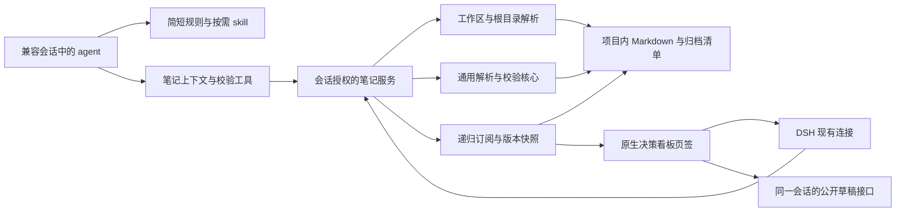

# DSH 决策笔记插件：实现方案

- 日期：2026-10-28。
- 状态：设计已收敛，实施与集成验证尚未开始。
- 产品约束：[PRD](./PRD.md)。任务与依赖：[TODO](./TODO.md)。
- 本轮只创建规划文档。下文的模块、契约和配置为拟实现内容，不表示已有代码。

## 1. 架构决定

采用同一插件包的宿主端、Web 客户端和集中 skill 资源。插件在 Web profile 挂载；看板注册到原生 `conversation.view`，自动绑定所属会话的项目。不修改 DSH 宿主，不增加独立服务器。



笔记数据和索引按工作区共享，浏览状态按会话保存。工作区文件是事实来源；插件缓存和归因基线可重建。读路径与归档等写操作分离，后台刷新与校验不修改项目。

## 2. 已核验接口与技术探针

以下是对本机 DSH `0.2.1-rc.2` 的静态核查结果，仍须通过 T-01 运行验证。路径是 DSH 包内定位，不能假设用户安装在同一个绝对目录。

| 能力 | 已核验的接口或位置 | 使用边界 |
| --- | --- | --- |
| Profile 插件 | `dsh-plugin-manager/README.md` 的 profile 范围；manifest 的 `dsh.bundle.patch`、`dsh.client` | 一次启用影响该 profile 的会话；跨 profile 需另行接入。Client 模块按 DSH 加载器构建，不能只导出任意 ESM 文件。 |
| 集中 skill | `dsh-skill` 的 `registerProvider`；`dsh-skill-office/lib/index.js:58` 的 bundled provider 示例 | 注册全局层，保留资源基址；项目或 preset 可遮蔽同名 skill。 |
| 规则注入 | `systemPrompt.section({ name, order, text, interpolate })` | 注册短 section，禁止接管 complete prompt；特殊 `complete: true` 会排除其他 section。 |
| 自动目录 | `dsh-tool-skill/lib/index.js:931` 的 agent/pre-step 处理 | 按 scope 与 cwd 发现摘要，正文按需加载；skill 工具不可见时不保证目录出现。 |
| 会话页签 | `dsh-client-ui-conversation` 的 `conversation.view`，类型为 list/session | 标准 props 有 session 绑定；空白会话隐藏页签与内容，沿用宿主行为。 |
| 项目定位 | `useSessions(s => s.byId[sessionId]?.cwd)`、工作区成员关系与 `WorkspaceView.path` | `useSession()` 自身没有 cwd；不存在可直接使用的公开 selectedWorkspace 字段。 |
| 文件读取变化 | `workspaceFiles.read/list/stat/changes(SessionId, ...)` | 目录监听仅直接子项，需要递归编排；不存在路径变目录后重建监听。 |
| 草稿回填 | 会话标准 props 的 `inputActions.captureInsertion()`、`insertText(text, span)` | 公开实现检查 draftRev、disposed、提交状态；不调用替换全稿或发送接口。 |

### T-01 需要补证的运行契约

- 最小 bundle/client 在当前 DSH 中加载和卸载，原生页签显示，主题变量可用。
- 选择现有 typed Remote/RPC 的具体承载方式，验证身份解析、错误、取消和重连，不自行绕过宿主鉴权。
- 对规则、skill 来源、正文资源和进程内子 agent 进行端到端检查。
- 校验摘要如何通过精简动态上下文或工具结果送达正确 agent；不会把另一会话的结果当作当前状态。
- 核验可绑定的真实任务生命周期接口。若没有可靠起止，使用插件自己的显式记录检查区间，不能把每一轮对话自动等同于一项任务。
- 检查目录覆盖设置、草稿回填，以及插件关闭后的资源释放。

接口和包的存在是静态证据；宿主是否激活相关服务、打包兼容及完整流程都以技术探针为准。初始兼容目标为已核查的版本，不能未经验证就声明支持所有后续 DSH 版本。

## 3. 代码与资源组织

建议结构如下，具体文件名可在 T-01 后按构建约束调整：

```text
cordis.patch.yml                  插件 bundle 挂载清单
src/
  index.ts                       宿主入口与服务注册
  contracts/                     插件自己的数据契约
  server/
    config.ts
    workspace-context.ts
    skill-provider.ts
    prompt-policy.ts
    note-tools.ts
    note-service.ts
    note-transport.ts
    note-watch.ts
    validation-service.ts
    issue-baseline.ts
    agent-feedback.ts
  client/
    index.tsx
    decision-board.tsx
    board-components.tsx
    board-store.ts
    note-renderer.tsx
    note-reference.ts
    board.css
  skills/dsh-write-notes/
    SKILL.md                     DSH 授权和命令适配正文
skills/write-notes-like-deepseek/
  SKILL.md                       保留通用正文
  scripts/lib/                   可独立分发的共享解析/校验/归档库
  scripts/                       兼容 CLI 包装入口
  references/ templates/ assets/ 原有独立 skill 资源
scripts/
  build-plugin.ts
  probe-dsh-contracts.ts
tests/
  core/ server/ client/ integration/
```

共享核心的源码必须位于通用 skill 的独立分发边界内，例如 `scripts/lib/`。插件可以依赖这个共享核心，复制安装后的 skill 不能反向依赖仓库外层 `src/`。CLI 包装保留现有参数与退出码，核心库接受显式 root，返回结构化结果，导入不自动执行、不退出宿主进程。

浏览器和打包脚本复用同一份纯解析逻辑；独立看板在发布/生成阶段嵌入必要代码，继续作为单文件使用。构建清单须包含复制安装需要的全部依赖。以 [现有安装检查](../../scripts/test-skill-install.mjs) 验证独立复制、符号链接、CLI、看板和归档回归。

构建 DSH skill 资源时，把适配正文和通用 references、templates、scripts、assets 组合成完整可访问资源目录。该目录是构建产物，不能依靠开发机器上的源码绝对路径。provider 暴露的名称仍为 `write-notes-like-deepseek`，并给出实际资源基址。

## 4. 工作区绑定与根目录

1. 客户端发送当前页签绑定的 sessionId；宿主使用现有会话/工作区服务核验所属关系并解析项目根，不能信任客户端直接传入的绝对路径。
2. 有工作区实体时优先使用其项目路径；会话 cwd 只作明确的兼容回退，且须验证与工作区关系。不能使用宿主启动目录或 agent 后续临时切换的目录。
3. 同一 resolver 为读取、检索、校验、归档和 agent 工具生成一致的 notesRoot。
4. 默认路径是项目根下的 `.agents/notes/`。路径覆盖存入插件/profile 配置，不要求写入每个项目。
5. 默认覆盖值使用工作区内相对路径；拒绝路径遍历、符号链接逃逸和未授权工作区。外部目录共享不作为本版默认支持能力。
6. 不存在目录时返回空态；首次获得授权的笔记写入才创建。访问被拒绝、目录缺失、非目录路径应给出不同状态。
7. 配置变化生成新 configRevision，取消旧任务与订阅，重新建快照及校验基线。切换根不移动旧笔记。

配置形状示意，属于插件设计，不是 DSH 现有字段承诺：

```json
{
  "workspaceOverrides": {
    "<workspace-id>": {
      "notesPath": "docs/decisions"
    }
  }
}
```

缓存以工作区身份、解析后的真实根目录、配置和规则版本隔离。不同 worktree 不因为共享 Git common directory 而合并数据。相同工作区的多个会话可共享读快照，但不能共享草稿或浏览状态。

## 5. Skill、默认规则与操作入口

### 5.1 全局挂载

宿主无 scope 的 provider 注册进全局层，短规则通过唯一命名 section 注入。摘要随 DSH 正常机制可见，完整正文通过 skill 工具按需加载，不反复灌入历史全文。

简短规则至少包含：非平凡改动前加载本 skill；用插件解析的项目根检索相关决策；跟随任务授权维护笔记；写完检查最新校验结果；机械改动跳过。

### 5.2 DSH 适配正文

原 [通用 Skill](../../skills/write-notes-like-deepseek/SKILL.md) 保留原有独立用途。DSH 正文明确替换普遍要求用户确认的交互段，不能让短规则与加载后的正文相互冲突：

- 已授权任务包含相关笔记的检索、起草、更新、归档和校验。
- 任务自身存在真实待定决策时询问用户，不能每篇笔记另设确认门。
- 所有操作使用插件提供的上下文与工具，或已解析的绝对资源路径和明确的 root；不假定项目配置了 npm scripts 或本地 skill 副本。
- 路径覆盖后，检索示例、写入目标、模板提示和校验入口全部使用实际根，不能只改看板读取位置。
- 用户直接指令和项目约束优先；不扩展到与当前任务无关的笔记清理。

插件工具可以提供上下文/检查区间初始化、检索、校验与归档等操作。工具名称与参数在 T-01/T-06 定义，不能描述成 DSH 已有 API。普通文件写入继续遵守会话的访问权限与观察规则；宿主插件不能利用进程权限绕开 agent 的写入限制。

### 5.3 兼容诊断

识别实际获胜的 skill 来源、skill 工具是否可见，以及规则是否能参与该 preset 的组装。项目/preset 同名遮蔽时不强行覆盖，展示有效来源；完整自定义 prompt、其他 profile 和外部 agent 后端均为明确边界。进程内 spawn/fork 的全局继承需实测，不由父会话 transcript 推断。

## 6. 笔记服务与实时同步

### 6.1 插件数据契约

建议提供会话授权的上下文读取、快照读取、正文读取、变化订阅和校验查询。以下为插件自有概念字段：

```text
WorkspaceContext:
  workspaceId, projectRoot, notesRoot, configRevision, capabilities
NoteSnapshot:
  workspaceId, configRevision, snapshotVersion, completeness, notes
Note:
  id(根内相对路径), lifecycle, class, title, date,
  sections, links, sourceVersion
ValidationResult:
  workspaceId, configRevision, rulesVersion, snapshotVersion,
  complete, issues
```

原始正文可按需加载，不要求每个列表响应包含全量 rawBody。节点身份使用规范化根内相对路径；重名 slug 不能作为唯一身份。生命周期移动应保留可定位的新旧路径信息，不能把旧缓存正文显示成移动后的最新文档。

### 6.2 订阅生命周期

- 服务端为同根、同配置的订阅维护版本快照，使用稳定快照与去抖合并保存事件。
- 递归管理目录及文件观察；原生监听是 depth 0，不能只订阅笔记根就宣称覆盖全部层级。
- 根不存在时监视最近可观察的父级/目标路径；变成目录后重建目录监听，并发现新增子目录。
- 首次订阅、断线重连、分支切换或检测到事件缺口时重新同步，不仅依赖增量事件。
- 扫描期间的变化进入下一代快照，结果带版本与完整性；失败或部分读取不能显示成完整成功。
- 客户端切会话、改配置、关闭页签或卸载时取消对应请求；迟到响应按身份和代次丢弃。
- 最后一个消费者离开且无 agent 检查需求时释放观察资源；插件停用时释放全部资源，不永久监视所有历史工作区。

看板和后台校验消费同一版本信息。agent 检查期间即使没有打开看板，也应能得到最新结果。延迟、文件数和内存目标由 T-01/T-10 选定数据集实测，不在规划文档中声称已达标。

## 7. 后台校验、基线与反馈

### 7.1 校验核心

复用现有目录、格式、链接、归档头部、SHA-256 封印及 Git 基线规则，保持无 Git 时的既有降级语义。只读校验不能调用写 seal 模式或自动更正 manifest。校验结果以结构化规则编号和路径返回，CLI 再格式化打印并设置退出码。

### 7.2 三类归因

| 分类 | 证据要求 | 行为 |
| --- | --- | --- |
| 本次引入 | 有完整、版本一致的检查起点，问题此前不存在或明显恶化，并能关联本次操作 | 要求 agent 修复与当前任务有关的问题。 |
| 历史已有 | 在该次检查起点的完整基线中已存在，且没有本次恶化证据 | 单列报告，不自动扩大为历史清理。 |
| 来源不确定 | 缺基线、扫描不完整、并发写入、checkout、重启、配置/规则变化等破坏可靠比较 | 如实标注，不能归责当前 agent，也不能冒充历史问题。 |

首次观察快照用于登记当时已有状态，不是所有后续任务永远共用的任务基线。issue key 由规则编号、规范化相对路径、稳定结构锚点及必要关联身份构成；行号和报错全文不是稳定身份。重命名、生命周期迁移、同一规则下错误数量或严重度恶化均需处理。

### 7.3 检查区间与任务边界

优先绑定 T-01 核验过的生命周期。没有可靠任务起止时，由 agent 在开始笔记维护前调用插件上下文/检查工具，得到 session 绑定的 reviewToken；这是插件自己的检查区间，不声称等于宿主开发任务。跨多轮维护显式延续 token，收尾显式查询最新结果。

记录区间绑定根、规则版本、配置版本和起始快照。无法可靠关联操作者时，新出现的问题只能作为候选或来源不确定；“这个文件被当前任务改过”不能证明其全部错误都是新引入。多个会话或外部工具并发时采取保守归因。

是否持久保存基线及其大小上限在探针后决定；重启后证据不足一律降级，不把当前磁盘重新读取的内容伪装成重启前的基线。

### 7.4 Agent 反馈

动态反馈只传递当前工作区和检查区间的简短状态、版本及可获取详情的入口；完整问题列表通过工具按需获取。不会把全项目正文或另一会话归因持续加入 prompt。

收尾必须请求覆盖最后一次相关修改的完整校验结果；仍在校验或结果过期时明确等待/重查，不能以旧绿色状态结束。后台通道不可用时回退显式工具查询，并说明没有取得自动反馈。该流程不添加系统级任务结束或 Git 提交阻断。

## 8. 看板与会话草稿

### 8.1 原生看板

注册 list/session 的 `conversation.view`，名称为【决策看板】，顺序位于原生【对话】【轨迹】之后。保留总览、时间线、避坑清单、目录、搜索/筛选、关联和全文阅读，复用 DSH 主题变量并处理宿主尺寸约束，避免嵌入内容样式污染宿主。

浏览状态以 session 为键，包括子视图、筛选、选中文档、必要滚动位置。笔记被删除或移动后更新选择与关联，显示明确状态，不保留失效的“最新正文”。目录缺失、加载中、权限错误、断线及校验未完成分别呈现。

### 8.2 引用回填

1. 点击时绑定当前页签的 sessionId、根配置和操作代次；尽量使用已加载标题和路径构造最小引用。
2. 如需异步读取摘录，绑定取消信号；会话切换、配置变化或视图销毁后停止操作。
3. 通过公开 `captureInsertion()` 取得插入位置和 draftRev，把捕获选区折叠到末端形成零长度 span，再使用 `insertText(text, span)`；只在同一代会话内操作。
4. 在光标或原选区末端插入，保留全部原文字、引用芯片、命令及附件；不以替换选中文字实现回填。避免异步期间用户新输入被覆盖。
5. 接口返回 false 时提示用户重试，不通过 setDraft 或私有 DOM 强制覆盖。引用正文包括标题和项目内可定位路径，摘录由用户明确选择。
6. 必要时返回【对话】视图，由用户补充要求并发送；不调用 submit、followup 或 steer。

公开接口存在和 revision 守卫已静态核验；实际选区、撤销、会话切换与附件保留由 T-09 进行组件/集成测试。

## 9. 展示与写入边界

- 项目正文是输入数据，不作为插件执行代码；Markdown 禁用未经净化的原始 HTML，链接协议采用允许列表。
- 项目内链接仅在授权根内解析；跨笔记跳转使用完整相对身份，不能按包含 slug 的模糊匹配跳到错误文档。
- RPC 接口验证 session 所属、请求路径、返回数量和取消状态，不因读接口原本允许越出工作区就扩大看板范围。
- 所有归档写入遵守授权与根目录检查；并发维护归档清单时避免丢失条目，保留原有只增不改和入站链接报告语义。
- 后台校验、只读看板和技能加载都不能借助宿主权限修改用户项目。

## 10. 验证、构建与交付

测试范围与 R 编号见 [TODO](./TODO.md)：核心解析和 CLI、复制安装、资源分发、多工作区/会话隔离、递归监听、归因、草稿回填、主题与安全渲染。

对实际 Web GUI 的验证必须使用该运行实例对应的插件产物。不能把独立 Vite 页面或另起的服务器当作已经更新了现有 DSH。Client HMR 是否可用取决于同一安装/checkout 的构建监听是否正在运行；否则先构建再刷新核验，不预先承诺无需刷新。

任务完成后按同主题提交，显式添加本任务文件；不提交依赖目录、缓存、日志、临时探针输出或不应入库的产物。功能接入、安装、发布或部署须在后续授权范围内执行，推送远端需用户明确要求。

## 11. 备选方案与取舍

| 方案 | 价值 | 当前选择 |
| --- | --- | --- |
| 独立工作区页签或标题入口 | 尚无会话即可进入，工作区级状态明确 | 用户明确选择原生会话页签，本版不增加宿主导航扩展。 |
| 原看板 HTML 直接嵌入 | 展示复用快 | 仍需解决浏览器目录句柄、主题、隔离和通信；采用原生页签组件复用布局与共享解析，不继续依赖手选本地目录。 |
| 每次注入完整 skill 和全量历史 | 规则和材料一次可见 | 用户选择短规则加按需加载，控制上下文成本。 |
| 直接导入现有 CLI | 初期改动较少 | 顶层 cwd/env 和 process.exit 不适合多工作区宿主；拆库并保留 CLI 包装。 |
| 硬性任务/提交门禁 | 可强化受控通道约束 | 用户选择自动检查与 agent 修复；系统级门禁不在本版范围。 |

## 12. 待技术验证项

尚未执行 T-01 的运行探针、构建与集成验证。尚待确认的是具体 API 组合、检查区间接入、反馈通道、资源打包、主题与性能，不是新的用户产品选择。若探针证明必须改变已确认的体验或增加宿主改动，应先记录证据并重新讨论该项，不能静默缩减需求。
