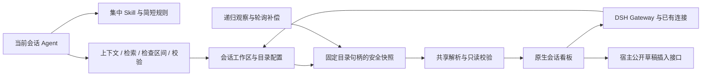

# DSH 决策笔记插件：实现方案

- 日期：2026-10-28。
- 实施分支：`feat/dsh-plugin`；规划基线提交 `8219543`。
- 产品约束：[PRD](./PRD.md)。任务：[TODO](./TODO.md)。运行证据与边界：[VALIDATION](./VALIDATION.md)。

## 1. 运行结构

插件在 Web profile 全局挂载，无需修改 DSH 宿主或各项目的配置文件。在原生 `conversation.view` 注册【决策看板】，接受宿主空白会话隐藏页签的规则。集中资源提供 `write-notes-like-deepseek` Skill，简短 system prompt 提醒 agent 按需加载全文。



项目 Markdown 与归档 manifest 是事实来源。缓存、检查区间、浏览状态和临时捕获目录均不是项目数据的替代存储。

## 2. 模块与资源分发

- `src/index.ts`：Cordis 插件入口、依赖声明、会话读取、`decisionNotes` Remote 服务和卸载。
- `src/contracts/`：工作区、笔记、校验及浏览器传输契约。
- `src/server/config.ts`、`workspace-context.ts`：profile 配置、固定会话归属和目录边界。
- `src/server/note-service.ts`、`note-watch.ts`、`scan-integrity.ts`：共享快照、安全捕获、递归观察、轮询补偿和回收。
- `src/server/validation-service.ts`、`issue-baseline.ts`：结构化校验、显式检查区间与保守归因。
- `src/server/skill-provider.ts`、`prompt-policy.ts`、`note-tools.ts`、`agent-feedback.ts`：全局 Skill、规则、工具和实际来源诊断。
- `src/client/`：原生看板、会话浏览状态、Markdown 阅读、变化流和草稿引用。
- `skills/write-notes-like-deepseek/scripts/lib/`：可独立分发的共享核心，原 CLI 仍是薄包装；纯解析器也嵌入独立 HTML。
- `src/skills/dsh-write-notes/SKILL.md`：覆盖通用确认门和固定根假设的 DSH 正文。
- `scripts/build-plugin.mjs`：服务端 ESM、宿主模块加载器包裹的客户端 CJS、CSS 文本和完整 Skill 资源。

构建输出为 `lib/` 和 `assets/write-notes-like-deepseek/`。后者同时包含适配正文、references、templates、scripts 和独立看板，不依赖开发机器的源码绝对路径。构建产物不入 Git。发布清单只包含插件必需资源；通用 Skill 从原目录复制或符号链接安装仍独立可用。

## 3. 宿主接口与传输

目标环境为 Linux、Node 24、DSH `0.2.1-rc.2`，Cordis `4.0.5`。服务端导入宿主协议，客户端 React 和 Cordis 等包由宿主提供，避免重复实例。

宿主 Remote 命名空间是 `decisionNotes`，方法包括 `context(sessionId)`、`snapshot(sessionId)`、`read(sessionId,id)`、`beginReview(sessionId)`、`validation(sessionId,reviewToken?)` 和 `changes(sessionId)`。每个方法显式声明 session 资源，沿用 Gateway 的访问控制；变化流每次交付前再次检查 RemoteAccess。客户端不能提交根目录或任意绝对文件路径。

一元调用使用现有 Connection RPC。变化流经 `remote.$mount`、现有 Gateway 和连接 mux 提供，客户端挂载后在声明了 `remote.decisionNotes` 的 Cordis 作用域消费。不能从仅注入 `remote` 的插件作用域直接读取动态命名空间；根 Context 的测试不足以验证这一约束。

插件标准依赖和客户端 inject 在包 manifest 中声明。使用标准 JavaScript decorators；不能启用与目标宿主不兼容的 legacy `experimentalDecorators`。

## 4. 会话与目录边界

解析器读取 live session 或 session persistence 的不可变 header.cwd，核对 WorkspaceRegistry 已持久 canonical 路径身份，不能对登记路径重新 realpath 后接受重定向。首次成功解析固定该会话的项目根，后续重定向或 header 变化拒绝；无显式成员的子会话可复用唯一同根工作区及配置，但原登记路径被重定向不能降级成 synthetic 工作区。真正未登记的回退拒绝符号链接根。未知会话、多归属或路径不匹配拒绝。agent 的临时 `working_directory` 不改变绑定。

默认目录是项目根内的 `.agents/notes`，工作区覆盖示例：

```yaml
- id: decision-notes
  name: write-notes-like-deepseek
  config:
    workspaceOverrides:
      "<workspace-id>":
        notesPath: docs/decisions
    pollIntervalMs: 1500
```

配置保存在 Web profile 的 patch 层。工作区 ID 可从 `notes_context` 或工作区界面获得。`notesPath` 必须是项目内相对目录，拒绝绝对路径、上级路径、空根和 Windows 分隔符。更改配置不迁移文件；重新建立服务、快照和基线。不同 worktree 按其独立真实目录处理。

读取缺失目录返回完整空态，不创建项目文件。路径不存在、非目录、权限拒绝和扫描失败有明确状态。配置版本在异步解析前后检查；请求返回前再次核对会话归属，旧目录与旧会话结果不交付。

## 5. 安全捕获与快照一致性

首版安全读取使用 Linux `/proc/self/fd`。从文件系统根开始逐级打开项目祖先、笔记目录和子目录，目录与文件均使用 `O_NOFOLLOW`。每层访问依赖已打开的父目录句柄，避免 realpath 检查后目录被替换为外部符号链接。根内符号链接也明确拒绝。

有界文件集写入插件私有的临时镜像，解析、正文和校验只使用该镜像。归档 append-only 检查的基线从真实项目 Git 获取后显式传入核心，不能把镜像的无 Git 环境误当原项目语义。临时镜像使用后立即删除，不修改项目或封印。

限制为单文件 4 MiB、文件总量 32 MiB、最多 10,000 条目、32 层目录和 5,000 篇看板笔记。超限返回不完整错误，不截断后冒充成功。读取期间文件大小/时间变化、前后捕获指纹不一致或 Git checkout 变化均导致不完整结果。

快照标识包含工作区、notesRoot、configRevision、snapshotVersion、sourceVersion、checkoutVersion 和完整性。相同内容可以保持 snapshotVersion，但最新校验时间仍更新。Git 无仓库、空仓库、已有提交但无归档 manifest 分别处理；子进程使用稳定错误语言，不依赖宿主中文文案。

## 6. 实时同步与生命周期

每个工作区、解析根和配置版本共享一个服务条目。Node `fs.watch` 监听各级目录，发现新增目录后重建观察集合；根缺失时监听最近存在的父目录。默认每 1.5 秒轮询补偿丢失事件、checkout 和根删除重建，文件事件去抖约 60 毫秒。

首次订阅与重连均发送完整快照。客户端按会话、配置和版本丢弃迟到数据，配置失效后重新拉取 context、snapshot 和流。关闭页签、切换会话或停用插件会取消相应消费；没有消费者和有效检查需求时停止观察，短时缓存随后回收。插件停用同时结束等待中的变化流，防止挂起订阅。

## 7. Skill、工具与权限

全局 provider 名为 `dsh-write-notes`，对外技能名称保持 `write-notes-like-deepseek`。简短 section 不接管完整 prompt。按需正文明确：任务授权包含相关笔记维护，只在真实待定决策时提问；所有读写目标使用 `notes_context` 返回的根。

提供六个 agent 工具：`notes_context`、`notes_search`、`notes_read`、`notes_begin_review`、`notes_validate`、`notes_archive_entry`。工具从调用 agent 的宿主会话身份解析工作区，不接受模型指定 sessionId。目标 DSH 在注册时强制 agent.id 等于 agent.session.id。

工具本身不写项目。归档入口只返回 executable 和 argv，由 agent 自身受权限约束的命令工具执行，不能借用宿主进程权限。CLI 归档和 `--write` 补封印共用跨进程排他锁；死进程遗留锁可以恢复，恢复标记异常遗留时安全超时并要求人工检查。

`notes_context` 展示实际获胜 Skill 的 provider、来源、资源基址，检查调用 scope 的 skill 工具和实际组装 prompt。项目或 preset 的同名 Skill 可遮蔽插件；complete prompt 可排除 section；外部后端、其他 profile 和不同 preset 不能未经验证就承诺覆盖。

## 8. 校验与归因

共享核心保留目录、格式、相对链接、归档头部、SHA-256 封印及 Git append-only 语义。后台校验只读。检查区间用会话绑定的 reviewToken 表示，默认内存保留 30 分钟，重启后不伪造历史基线。

issue key 使用规则、根内路径及结构锚点，避免行号和整段报错成为身份。完整起点可识别未恶化的历史问题；未知基线、不完整快照、规则/配置/checkout 变化、并发以及无操作证据的新问题均降级为来源不确定。

现有普通文件工具和外部编辑不提供可验证作者证据，内容变化或重叠检查区间按潜在并发处理。只有额外提供独立可核验操作证据时才允许标记本次引入，不能仅因文件被改动就归责。看板分别呈现本次引入、历史、来源不确定的问题及 warnings。

收尾 `notes_validate` 等待已有扫描后发起自己的新扫描，并核对最后的会话身份；检查起点遵循同样屏障。不存在宿主 task API 假设，也不新增结束任务或 Git 提交硬门禁。

## 9. 看板与草稿

看板包括总览、时间线、避坑、目录、全文搜索、状态与类别筛选、排序、精确路径关联及全文阅读。CSS 限定插件作用域并使用宿主明暗主题变量。浏览筛选、选中项和滚动按会话保存；数据与校验按工作区共享。文档移动或删除后清除失效选择。

Markdown 以 React 文本和受控元素渲染，原始 HTML 不执行；外链使用协议允许列表，笔记跳转使用完整根内相对身份，不按 slug 模糊匹配。

引用使用宿主标准 props 的 inputActions。捕获选区后折叠到末端，使用零长度 span 与 draftRev 调用 insertText；插件不调用 setDraft、submit、followup 或 steer。操作绑定 session、配置和代次，流变化立即更新守卫；宿主拒绝时提示重试。保留原草稿、引用芯片和附件，由用户发送。

## 10. 构建、运行与验证

```sh
npm ci
npm run build:plugin
npm test
npm pack --dry-run
```

本地接入使用 `dsh plugin --profile web add link:<仓库绝对目录>`，发布包可先 `npm pack` 再安装生成的 tarball。启用后刷新现有 GUI 验证；不要用独立 Vite 页面代替实际 DSH。构建了当前 client 产物不等于所有浏览器自动刷新，只有对应宿主开发 watcher 激活时才承诺 HMR。

本轮验证及最终测试接入清理状态、截图、命令和实测数据统一记录在 [VALIDATION](./VALIDATION.md)。没有覆盖的平台和后端继续作为明确边界。默认不 push、不发布 npm、不做长期部署。
